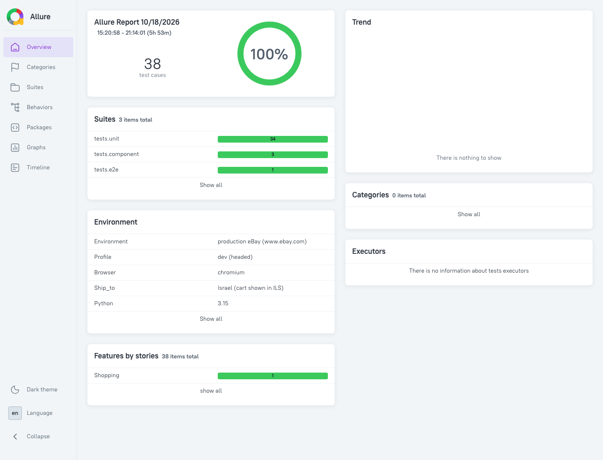
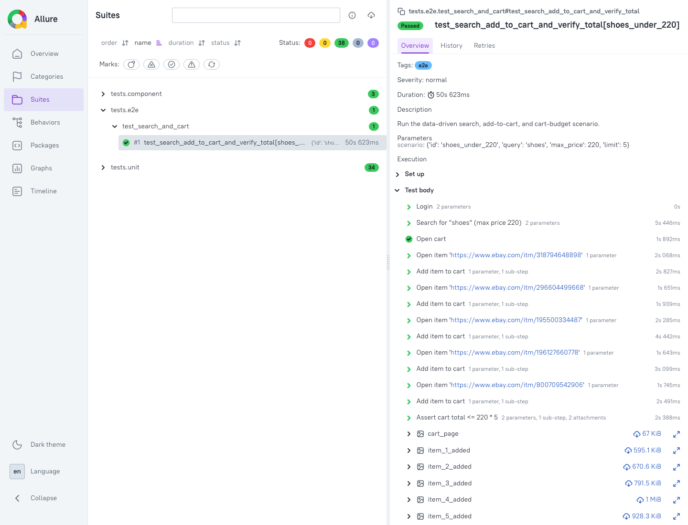

# eBay E2E Automation (Playwright + Python)

End-to-end scenario on eBay: search products under a price limit, add them to the
cart, and verify that the cart subtotal does not exceed the budget. Built with the
Page Object Model, OOP, and data-driven test inputs.

**Sample run:** [docs/sample-run/](docs/sample-run/), a passing E2E run with an Allure
report, JUnit XML, and screenshots ([details below](#sample-run)).

## Prerequisites
- Python 3.10+
- Allure CLI to view reports (`brew install allure`, optional)

## Setup
```bash
python -m venv venv
source venv/bin/activate              # Windows: venv\Scripts\activate
pip install -r requirements.txt
playwright install chromium
cp .env.example .env                  # optional: profile, URLs, credentials
```

### Save a browser session (recommended before E2E)
eBay often shows a human-verification page to automated browsers. Solve it once by hand
and reuse that session:
```bash
python -m scripts.save_session        # a browser opens: complete any verification, then press Enter
```
This writes `artifacts/auth/state.json`, and every E2E test then loads it automatically.
The file contains session cookies. It is ignored by Git and must not be shared.

The step is optional: try without it first. Without a saved session, every run starts as a
fresh guest with an empty cart.

A saved session keeps the same eBay cart between runs. Because the scenario requires an empty
starting cart, delete `artifacts/auth/state.json` (or empty the cart) before running again.

## Run
```bash
pytest -m unit                        # fast unit tests, no browser
pytest -m component                   # offline browser tests: XPath locators + paging on local HTML
pytest -m e2e -s                      # live E2E against www.ebay.com: every scenario in the data file
pytest -m e2e -k <scenario_id> -s     # a single scenario, by its `id` from data/search_scenarios.json
TEST_ENV=ci pytest -m "unit or component"   # what CI runs
```
No product is hardcoded in the code: queries, price limits and budgets come only from the
scenario file, which `SCENARIOS_FILE` can point elsewhere.

Reports:
```bash
allure serve reports/allure-results   # interactive Allure report
# reports/junit.xml is always written as well
```

## The four required functions
All four are in [flows/shopping_flow.py](flows/shopping_flow.py) (`ShoppingFlow`):

| Exercise function | Implementation |
|---|---|
| Authentication | `login()`: signs in with `EBAY_USERNAME`/`EBAY_PASSWORD`, otherwise continues as guest |
| `searchItemsByNameUnderPrice` | `search_items_by_name_under_price(query, max_price, limit=5)` |
| `addItemsToCart` | `add_items_to_cart(urls)` |
| `assertCartTotalNotExceeds` | `assert_cart_total_not_exceeds(budget_per_item, items_count)` |

## Architecture
```
config/      settings.py + YAML profiles (dev, ci); environment variables override the profile
data/        external test data: search_scenarios.json (+ the same data as .csv)
pages/       Page Objects, one class per page; all locators live here
  base_page.py    shared helpers: navigation, screenshots (also attached to Allure), access-challenge detection
  search_page.py  search with price filter, XPath card parsing, paging
  item_page.py    random variant selection, Add to cart, confirmation check
  cart_page.py    reads the displayed subtotal
  login_page.py   sign-in, falls back to guest
flows/       ShoppingFlow: business-level steps composed from page objects
utils/       price_parser, data_loader (typed SearchScenario), logger (console + file)
tests/
  unit/        page/flow logic with mocks
  component/   real Playwright + real locators against local HTML (paging, price filter, dedup)
  e2e/         data-driven live scenario
scripts/     save_session.py: manual verification + session save
```
- **SRP:** pages know only the DOM, the flow knows only the business steps, and parsing,
  data, and logging are separate utils. Tests just call the flow.
- **Fixtures** ([tests/conftest.py](tests/conftest.py)): one browser per session and a
  fresh context per test with Playwright tracing. On failure, the fixtures attach a screenshot.

## Robustness
- **Search:** the price ceiling is applied through eBay's URL filter (`_udhi`), and each
  card's price is still checked client-side, because sponsored and range-priced cards can
  slip through the filter.
- **XPath locators** match both the old (`s-item`) and new (`s-card`) eBay result-card markup.
- **Paging:** follows "Next" until `limit` items are collected or the pages run out. Returns
  a partial list, or an empty one, when fewer items exist.
  - Waits for the URL to change before reading cards, so cards from the previous page are
    never re-read.
  - If the URL doesn't change, it checks whether the results changed.
  - **Termination is guaranteed.** Paging stops on the first of these:
    - `limit` items were collected.
    - There is no enabled Next link.
    - `max_pages` pages were read (profile or `MAX_PAGES`; `dev` uses 5, `ci` uses 10).
    - The `search_timeout_s` time budget ran out (profile or `SEARCH_TIMEOUT_S`).
    - A page added no item that wasn't already seen. This covers endless or
      infinite-scroll-style pagers that keep serving the same items.
    - Next points to, or leads back to, a page that was already visited.
    - The next page shows no result cards within `default_timeout_ms`. This ends paging
      cleanly instead of hanging or raising.
  - Each rule has an offline test in [tests/component/test_search_paging.py](tests/component/test_search_paging.py).
- **One currency end to end:**
  - A results page can mix currencies, for example `ILS 58.80` next to `$20.00`.
  - The comparison currency is `CURRENCY` when it's set. Otherwise it's the currency most
    cards on the first page are shown in.
  - Cards in any other currency are skipped.
  - The cart total must be in the same currency, or the assertion fails instead of
    comparing incomparable numbers.
- **Price parsing** ([utils/price_parser.py](utils/price_parser.py)): returns `Money`
  (a `Decimal` amount plus an ISO currency code).
  - Recognizes symbols and codes such as `US $`, `C $`, `ILS`, `€`, and `£`, plus US and EU separators.
  - Amounts with a currency marker win over bare numbers, so `2 for $19.99`,
    `save 20% $90.00`, and `$59.99 + $10 shipping` all parse to the item price.
  - Only an explicit `X to Y` counts as a range, and its lowest price is used.
- **Variants:** random choice (seeded via `random_seed`, so runs are reproducible) among
  available options in both native `<select>` and custom listbox dropdowns. Placeholder,
  disabled, and out-of-stock options are skipped.
- **Add to cart** succeeds when a confirmation appears or the cart badge count increases.
  On failure, it saves a screenshot and the buy-box HTML.
- **Access challenges** (CAPTCHA) are detected, screenshotted, and reported as an explicit
  skip. They are never bypassed.

## Locator strategy
- **XPath** for the search results (cards, prices, links, Next). The exercise requires it,
  and the `or` conditions match both of eBay's result-card markups.
- **User-facing locators** (`get_by_text`, `get_by_role`, `get_by_placeholder`) where visible
  text or roles are the stable contract, such as "Added to cart", "Subtotal", or the search button.
- **CSS** where it is shorter or the only option. Every CSS locator has an inline comment
  explaining the choice. The reasons:
  - Stable element ids, as on the sign-in form.
  - A single ARIA attribute (`aria-haspopup`).
  - Playwright-only pseudo-classes that have no XPath equivalent (`:visible`, `:has-text()`).
  - Selectors that also run inside the browser through `document.querySelector`, which accepts CSS only.

## Data-driven and configuration
- Scenarios come from `data/search_scenarios.json`. Any JSON/YAML/CSV file in `data/` can be
  used instead: `SCENARIOS_FILE=search_scenarios.csv pytest -m e2e`.
- Scenario fields: `id`, `query`, `max_price`, `limit`, and an optional `budget_per_item`
  (defaults to `max_price`).
- Profiles: `TEST_ENV=dev|ci` selects `config/profiles/<env>.yaml` (URLs, browser, headless,
  timeouts, locale, seed). Any field can be overridden with an environment variable or `.env`:
  `BASE_URL`, `CART_URL`, `BROWSER`, `HEADLESS`, `SLOW_MO_MS`, `DEFAULT_TIMEOUT_MS`,
  `LOCALE`, `RANDOM_SEED`, `CURRENCY` (for example `ILS` or `USD`; when it's unset, the currency
  is detected from the results), `MAX_PAGES`, `SEARCH_TIMEOUT_S`, `EBAY_USERNAME`, `EBAY_PASSWORD`.

## Security disclaimer (credentials)
> Credentials are read from environment variables or a local, Git-ignored `.env` file.
> Keeping a test account's username and password in plain text like this, or hardcoding them,
> is acceptable **only for this practice repository**. It must not be mirrored in production.
> There, credentials belong in a secrets manager or CI secrets, are never committed, and are
> never logged. The same disclaimer appears in [config/settings.py](config/settings.py),
> [pages/login_page.py](pages/login_page.py), and [.env.example](.env.example).

## Reports and evidence
- **Allure:** steps for every page action, screenshots for each added item and the cart,
  the run log, and the Playwright trace.
- **JUnit XML:** `reports/junit.xml`.
- **Artifacts** (`artifacts/`, ignored by Git): `screenshots/`, `traces/` (open with
  `playwright show-trace <zip>`), and `logs/run.log`.

<a id="sample-run"></a>
### Sample run ([docs/sample-run/](docs/sample-run/))
- `allure-report/index.html`: a self-contained Allure report. Download it and open it in a browser.
  - It contains the passing E2E run (`shoes` under 220, 5 items) plus the unit and component suites.
  - The 45 MB trace was left out to keep the repository small.
- `junit-e2e.xml`, `junit-offline.xml`: JUnit reports.
- `screenshots/`: each added item and the final cart.
  - The run started with a fresh guest session and an empty cart.
  - All 5 item ids were found in the cart.
  - The subtotal was ILS 720.02, including shipping, against a threshold of 220 × 5 = 1100.




## Assumptions and limitations
- **Login:** optional. Without credentials, or when sign-in is blocked, the flow continues as guest.
- **Currency:**
  - `max_price` and `budget_per_item` are amounts in the comparison currency (see Robustness).
    There is no exchange-rate conversion.
  - eBay shows prices in the currency of the ship-to location. In the sample run that was
    Israel, so search results and cart were both in ILS.
  - eBay's own URL price filter (`_udhi`) only narrows the results. The real price check is
    the per-card comparison in the chosen currency.
- **Cart must start empty:** the assertion checks the cart's whole displayed total, as the
  exercise requires.
  - So the flow verifies the cart is empty before adding anything, and fails with a clear
    message if it isn't.
  - It never deletes items itself. Empty the cart, or use a fresh session, before a run.
- **Cart verification:**
  - Every added item id must be present in the cart.
  - The cart's "Items (N)" count must equal the number of added items.
  - The total must be ≤ `budget_per_item × items_count`.
- **Subtotal** is read exactly as the site displays it, so it can include shipping.
- **Quantity** is left at 1. A random quantity above 1 would break the invariant that every
  item costs at most `budget_per_item`, which the cart assertion depends on.
- **Negative cases:** budget exceeded, currency mismatch, missing item, wrong count, and
  non-empty starting cart are covered in [tests/unit/test_cart_assertions.py](tests/unit/test_cart_assertions.py).
- **Live-site dependence:** inventory, prices, and DOM can change between runs, so live E2E
  is not part of CI. CI runs the deterministic unit and component suites
  ([.github/workflows/tests.yml](.github/workflows/tests.yml)).
- **Sandbox:** optional. It usually has no inventory. To use it, set `BASE_URL=https://www.sandbox.ebay.com` and `CART_URL=https://cart.sandbox.ebay.com`.

## AI bugs analysis
See [ReadMeAIBugs.md](ReadMeAIBugs.md).
